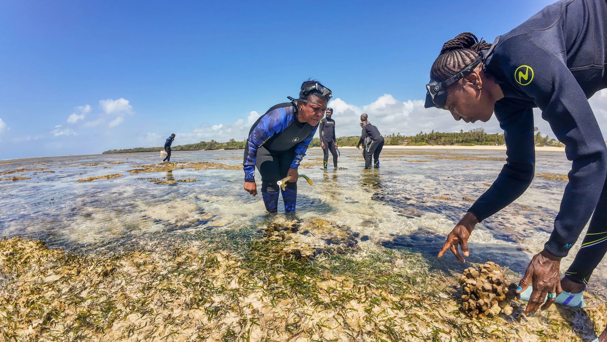
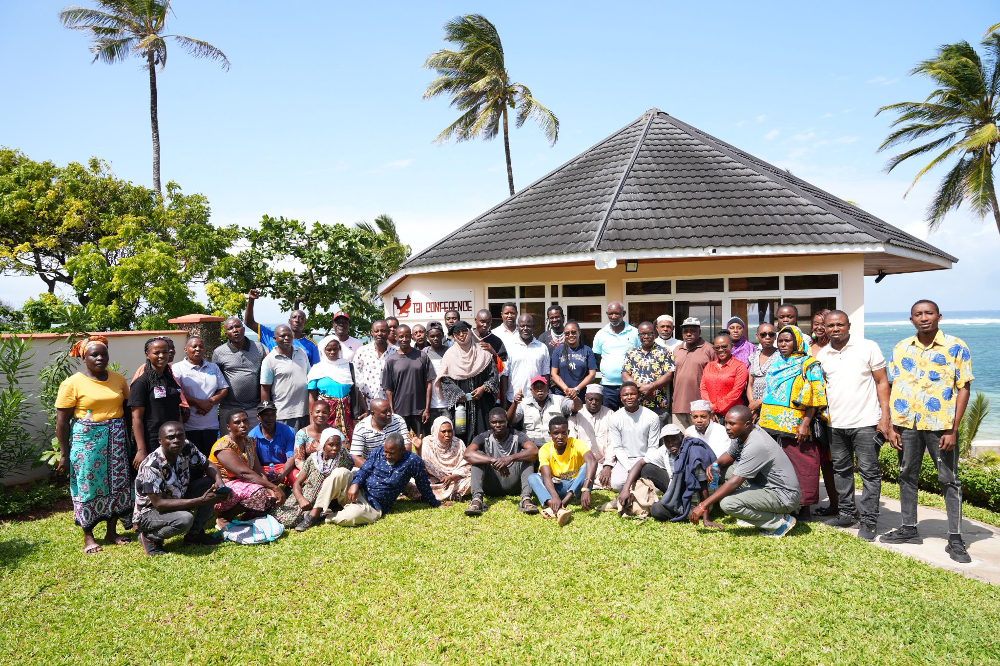

Annual reports are usually written backward - from outcomes to inputs, from impact to effort, from the headline numbers to the human stories underneath them. This one starts differently. It starts with a question: what did 2024 feel like?

It felt like arrival. Not in the sense that the work is done - it is not, and may never be, and that is the nature of conservation work in a world of accelerating climate change. But 2024 was the year when several long-running efforts converged into something bigger than their parts. The coral restoration programme passed 25,000 colonies planted. The co-management zone registered its first full year of formal governance data - and the data showed what the fishers already knew: the fish are coming back. And the IUCN World Conservation Congress, held in 2025, was shaped by months of preparation that defined much of 2024.

The numbers tell part of the story. 25,000 coral colonies planted with an 85% survival rate that exceeds most comparable programmes globally. 150 km² under formal community co-management. 120 women employed in Trash4Cash, removing 2+ tonnes of plastic monthly. 2,500+ students reached through ocean education. 14 active programmes spanning ecosystem restoration, fisheries governance, livelihoods, education, health, and media.

> "2024 was not the year we scaled. It was the year we proved we could scale without losing the thing that makes us work: the community."
>
> — Des Bowden, Director & CEO, Oceans Alive Foundation

But the numbers that matter most are harder to quantify. The moment when a BMU chair said, in a governance meeting attended by county and national government officials, "this is our ocean and we will govern it." The daughter of a Trash4Cash participant who announced she wants to study marine biology. The 67-year-old fisherman who, for the first time in his adult life, saw a bumphead parrotfish on the Kuruwitu reef.

In 2025 and beyond, Oceans Alive will expand the co-management zone, launch the digital reef monitoring platform, open the Watamu Youth Marine Education Centre, and continue making the case that community-led conservation is not a compromise between human development and ecological recovery - it is the only model that achieves both. The annual report is available to download from our resources page.
