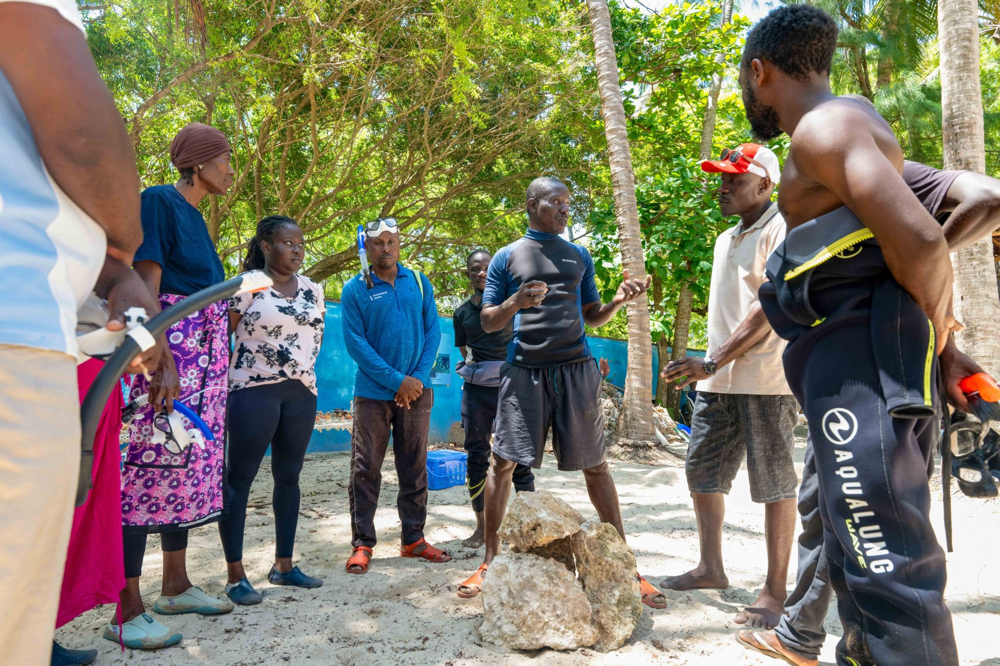
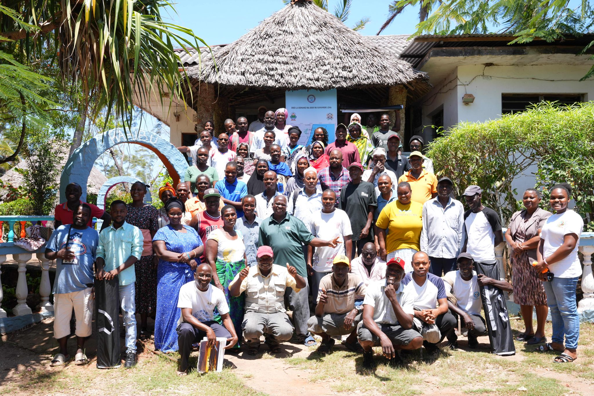

In January 2025, the Kuruwitu Beach Management Unit - one of Kenya's most closely watched community marine governance bodies - held its biennial leadership election. What might have seemed like a routine administrative exercise was, in practice, something more significant: a test of whether a governance model built over twenty years could survive the most basic challenge facing any institution - the peaceful transfer of power.

It passed. The election was organised and administered entirely by the BMU itself, overseen by an elected oversight committee. Three candidates stood for the chair position. There was debate, there was canvassing, and there was a result that all three candidates accepted. The outgoing chair, who has served since 2021, gave a speech that community members present described as one of the most moving they had heard - a final accounting of what four years of governance had achieved and what remained undone.

The new leadership has set out an agenda that is ambitious by any standard. First priority: the launch of a digital reef monitoring platform that will allow community members, researchers, and government officers to access fish biomass data, coral cover assessments, and enforcement logs in real time via a mobile app. The platform is being developed in partnership with a Nairobi-based conservation technology startup.

> "We are not here to maintain what exists. We are here to build what has never existed before - ocean governance that truly belongs to the people who live by the sea."
>
> — Newly elected BMU chair, Kuruwitu, January 2025

Second priority: an application to extend the co-management zone by a further 15 km² to the north, incorporating a reef system that has been unprotected for two decades and that community surveys suggest has significant recovery potential. The application is before Kenya's Marine Fisheries Research Institute for technical assessment, with a decision expected before the end of 2025.

For Oceans Alive, the election and the new leadership agenda represent something important: the co-management model is not dependent on any single individual, any single partner organisation, or any single funding cycle. It is self-perpetuating. The community owns it, elects it, and drives it forward. That was always the goal.
