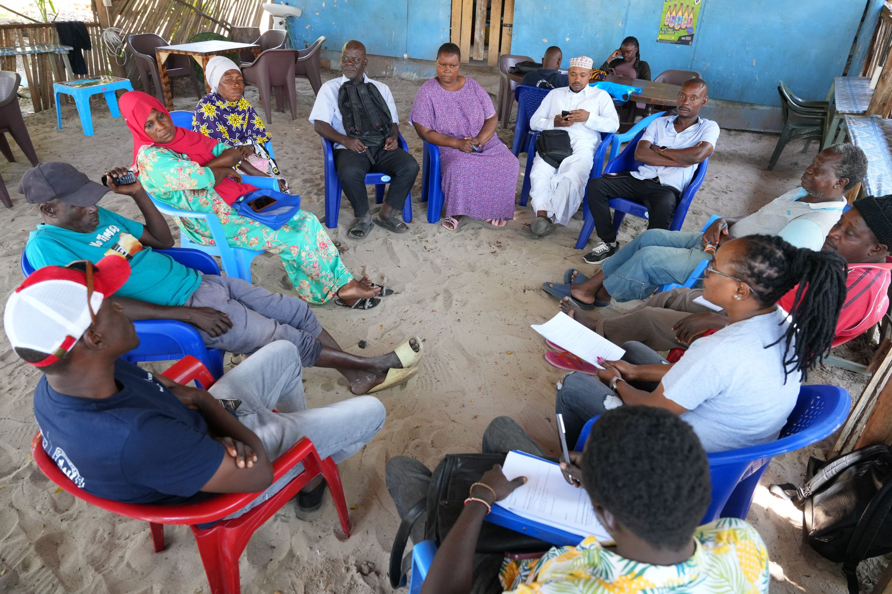
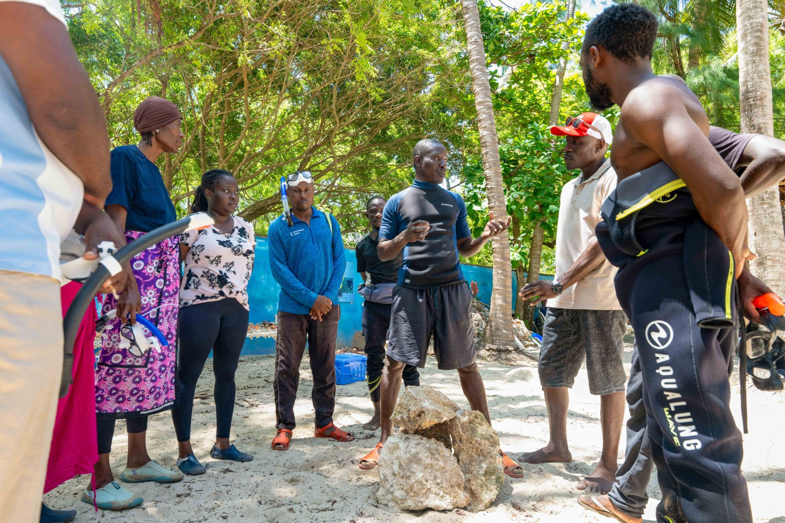

In January 2022, Oceans Alive Foundation achieved something that had never been done before in Kenya: the delivery of the country's first formal ocean co-management plan under the new Kenya Fisheries Act. The plan placed 150 km² of ocean - expanded from the original 30-hectare Kuruwitu sanctuary - under community-led governance.

The journey to this moment took nearly two decades. It began in 2003 when Des Bowden responded to fishers whose livelihoods were collapsing. It moved through the establishment of the Kuruwitu Conservation and Welfare Association, the creation of Kenya's first permanent marine sanctuary, and years of relationship-building with government fisheries officers, county administrators, and national policymakers.

The co-management plan defines fishing zones, seasonal closures, gear restrictions, and community governance structures across the entire Kuruwitu Joint Community Marine Area. It is legally enforceable, recognised by the county and national government, and - crucially - owned and administered by the fishing communities themselves through their Beach Management Units.

> "This is not just a plan on paper. It is the community saying: this ocean belongs to us, and we will protect it."
>
> — BMU chair, Kuruwitu

The BMU network that administers the plan represents thousands of registered fishers across multiple villages. Monthly meetings address compliance issues, maintenance of the monitoring programme, and reinvestment of sanctuary dividends back into community development. The governance model has been studied by policymakers from Uganda, Tanzania, and Mozambique as a blueprint for marine governance in the Western Indian Ocean region.

For the communities involved, the plan represents something deeper than policy. It is the formalisation of a relationship between people and the sea that has sustained coastal Kilifi for generations - and a commitment to sustain it for generations to come.
