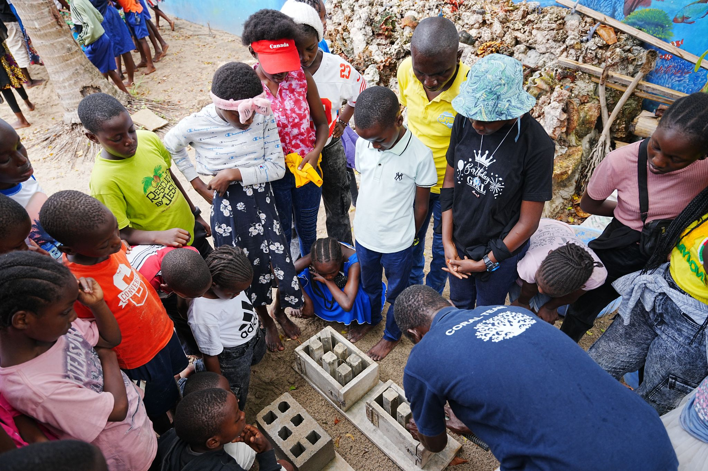
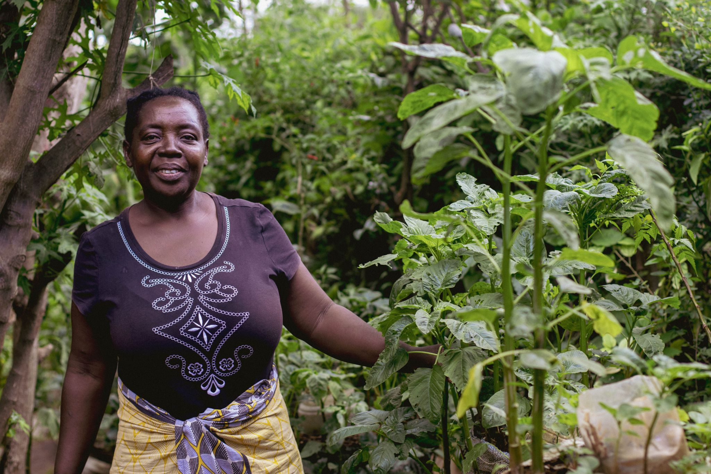

Every conservation programme has numbers. Oceans Alive has some of the best: 25,000 coral colonies, 400% fish recovery, 150 km² under management. But numbers exist at a distance. They don't tell you why a fisherman wept the first time he saw a bumphead parrotfish return to the reef he had protected for fifteen years. They don't capture what it means to a fourteen-year-old girl when she snorkels in her community's protected zone and sees a reef she didn't know was possible.

We spent three weeks travelling the Kilifi coastline - from Kuruwitu to Watamu to Vipingo - and asking residents, unscripted, what the ocean means to them. Fifteen people sat with us. They spoke in Swahili, in Giriama, in English, and in combinations of all three. This is what they said.

Mohammed, 67, retired fisherman, Kuruwitu: "My father taught me to fish on this reef. His father taught him. But when I was your age, the fish were leaving. I was afraid that when my sons grew up, there would be nothing left. Now I take my grandchildren to the protected zone and I show them what a reef is supposed to look like. I did not think I would live to see this."

> "The ocean does not belong to me. I belong to it. Every decision I make is about whether my grandchildren will still be able to say the same."
>
> — Elder fisherwoman, Vipingo village

Amina, 34, Trash4Cash group leader, Watamu: "The ocean gives us food. The ocean gives us income. When we clean the beach, we are not doing it for the tourists - we are doing it for ourselves. A dirty ocean is a dying ocean, and a dying ocean means our children go hungry. It is that simple." And James, 29, youth volunteer: "I used to think conservation was for rich people. Oceans Alive showed me that the most important conservation happens in the communities where people actually live by the sea. That changed everything."

What strikes you, spending time with these communities, is how little daylight there is between practical survival and principled stewardship. Nobody here is protecting the ocean out of abstract concern. They are protecting it because it is the ground beneath their feet - the source of their food, their income, their identity, and their children's futures. Conservation that ignores this is conservation that will fail.
