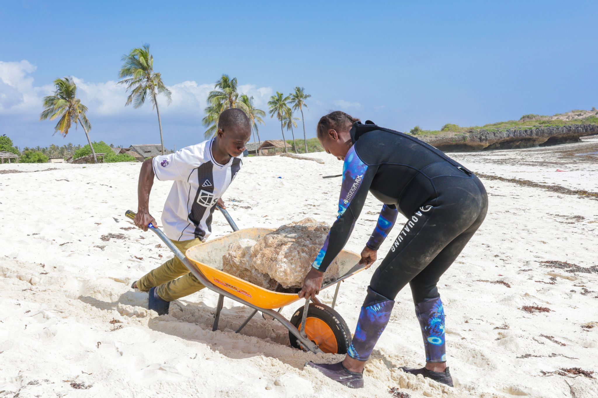
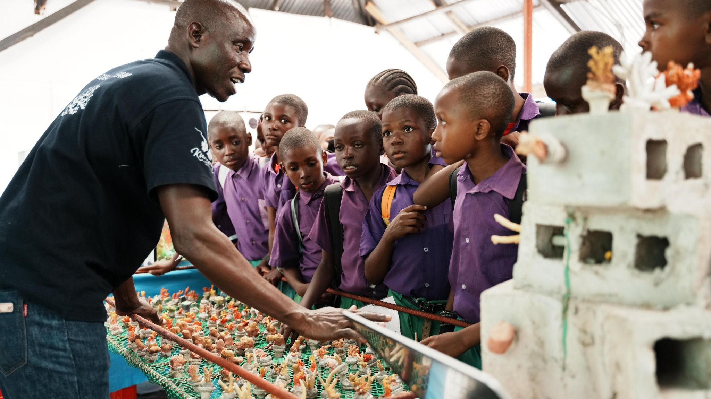

In 2019, Oceans Alive Foundation partnered with Coral Guardian International to begin Kenya's most ambitious community-led coral restoration programme. What started with a handful of trained fishers and a single underwater nursery has grown into a programme that has placed over 24,800 coral colonies back onto Kilifi's degraded reefs.

The methodology is deceptively simple: fragment healthy coral, grow it in underwater nurseries for three to six months until it is strong enough to transplant, then carefully attach it to dead or dying reef structures using stainless steel nails and hydraulic cement. The complexity is in the detail - choosing the right coral species for each microenvironment, monitoring for disease and bleaching, managing nursery predators, and training community members to do all of this safely and precisely.

The programme's 85% coral survival rate - measured from nursery to one year post-transplant - places it well above the global average of around 50-60%. Researchers attribute this success to two factors: the use of locally-sourced coral fragments that are already adapted to Kilifi's specific water conditions, and the deep investment of the community divers who tend to the nurseries with the same care that farmers give to crops.

> "The reef is not just recovering - it is growing. We see fish we haven't seen in twenty years."
>
> — Community diver, Kuruwitu

Today, over 40 community members are trained and certified reef gardeners. Many of them were fishers who once relied on dynamite fishing or walked across coral flats to gather invertebrates. Now they are the reef's most committed protectors - because their identity, their income, and their pride are tied to its recovery.

The ecological results are becoming undeniable. Fish biomass within the Kuruwitu protected area has increased by an estimated 40% since the programme began. Species not seen in decades - including several grouper species and the critically endangered bumphead parrotfish - have been documented returning to the restored zones.
