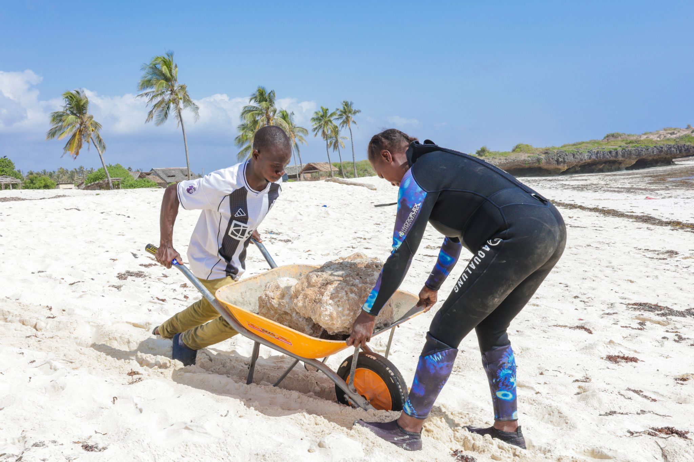

At the 2025 IUCN World Conservation Congress - the world's largest conservation forum - Oceans Alive Foundation presented the Kuruwitu co-management model to an audience of scientists, policymakers, and civil society leaders from more than 160 countries. The presentation was one of the most attended sessions of the congress.

The Kuruwitu model was presented as a case study in scaling: how a 30-hectare community sanctuary became a 120 km² nationally recognised marine governance zone; how a handful of committed fishers became a certified cadre of 40+ reef gardeners; how a local initiative became a nationally replicated framework under Kenya's new Fisheries Act.

Delegates from the Western Indian Ocean region - including representatives from Tanzania, Mozambique, Madagascar, the Seychelles, and Comoros - attended a dedicated side event on translating the Kuruwitu approach to their own contexts. Oceans Alive facilitated a structured exchange between Kilifi community leaders and coastal fishing communities from three other countries, creating direct peer-to-peer learning that no amount of policy documentation could replicate.

> "Kuruwitu is not just a success story from Kenya. It is a blueprint for how the world can save its coastal oceans."
>
> — IUCN session chair, 2025

The congress also served as the occasion for the formal launch of a regional network of community-managed marine areas along the East African coast - an initiative that Oceans Alive has been supporting behind the scenes for three years. The network will share monitoring data, governance frameworks, and technical expertise across borders.

For the Oceans Alive team, the IUCN congress was both a milestone and a reminder of the work still ahead. Climate change is accelerating coral bleaching events. Illegal, unreported, and unregulated fishing continues to undermine even the best community governance. Plastic pollution has not been solved. The world needs many more Kuruwitus - and it needs them soon.
