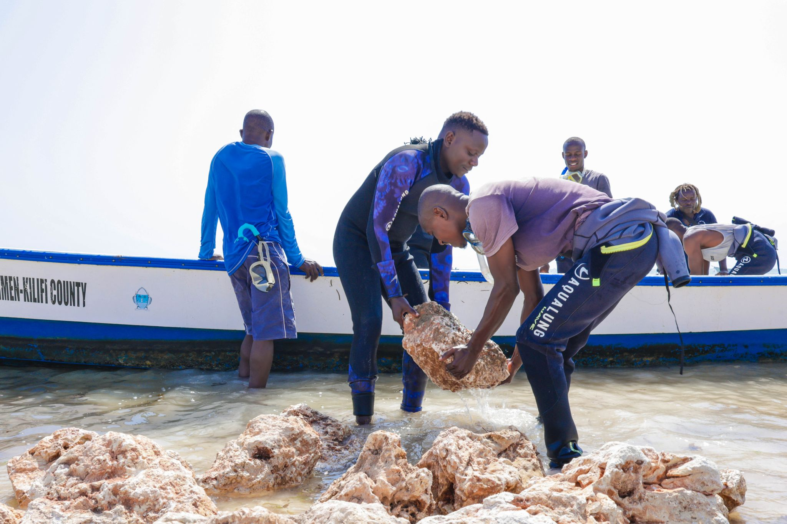
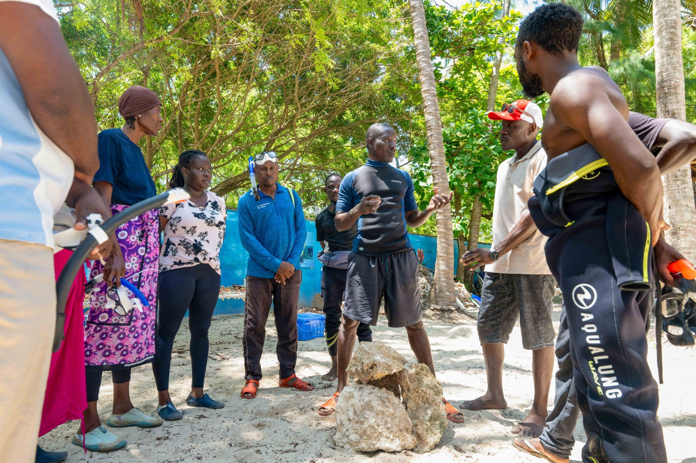

Stand at the edge of the Kuruwitu reef flat at low tide and look out. The water is so clear you can read the colour of the coral from shore. There are parrotfish grazing in water barely deep enough to cover them. A white-spotted grouper pauses in the shadow of a brain coral, then drifts lazily into the blue. Two decades ago, this scene was impossible. The reef was rubble.

In the early 2000s, Kilifi's fishing communities were in crisis. Dynamite fishing had shattered the reef structure. Over-harvesting with illegal beach seine nets had stripped the water column of fish that communities had relied on for generations. Fishers were travelling thirty kilometres offshore to catch what their grandfathers had found twenty metres from shore. The economics of fishing were breaking down, and with them, a way of life.

It was in this context that a British marine conservationist named Des Bowden sat down with the fishermen of Kuruwitu village and asked a simple, radical question: what would it take for you to stop fishing one section of the reef permanently? The answer - which emerged from dozens of meetings over months - required trust, governance, and a shared belief that sacrifice today would mean abundance tomorrow.

> "Twenty years ago I could walk across that reef and see nothing. No fish, no colour. Now I go underwater and I cry - because it is alive again."
>
> — Community elder, Kuruwitu Village

What followed was the establishment of Kenya's first community-managed no-take zone: a 30-hectare permanent sanctuary created not by government decree but by the voluntary decision of the fishing community that depended on it. Over the next fifteen years, that sanctuary grew - not just in area, but in proof. Fish populations within the zone increased by an order of magnitude. Species returned that had been absent for decades.

By 2022, the numbers were undeniable. Fish biomass within the co-managed zone had increased by more than 400% compared to baseline measurements from 2003. The spillover effect into adjacent fishing areas was real and measurable. Fishers who gave up twenty metres of reef twenty years ago were now catching more fish, more reliably, than at any point in living memory. The 25,000 coral colonies planted since 2019 by certified community reef gardeners accelerated the recovery, closing the loop between coral restoration and fisheries in a way rarely achieved in conservation practice.

The Kuruwitu model has been recognised by the IUCN World Conservation Congress as a blueprint for marine governance across the Western Indian Ocean. But for the fishers who sat in those early meetings - who made the decision to protect, and kept it - it is simpler than that. It is their reef. They brought it back. And their children will inherit an ocean that is alive.
