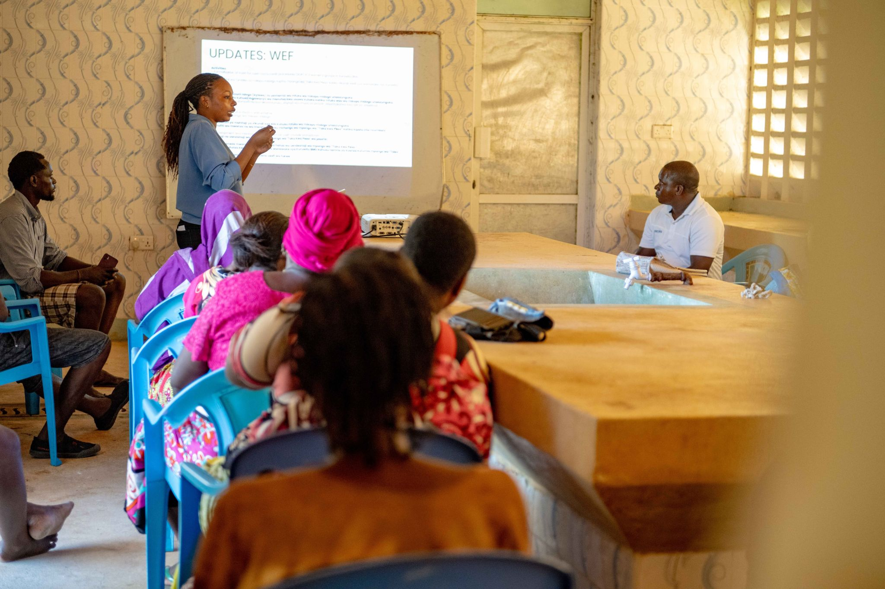
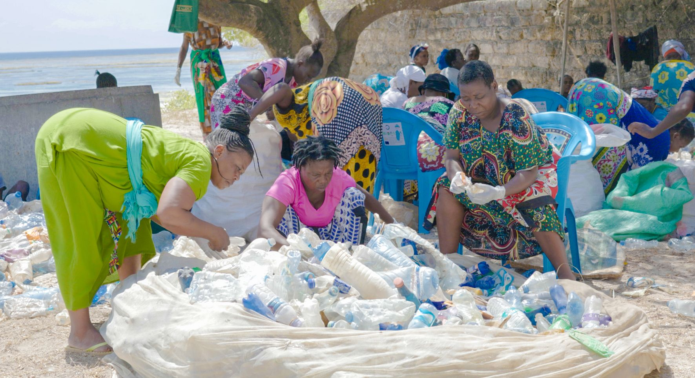

On a bright Saturday morning in February 2025, fifteen women from the LIFT Network opened what they call Soko la Bahari - the Sea Market - in Watamu. The name is deliberate. These are not products shipped from Nairobi, not generic handicrafts sourced at wholesale. They are hand-dyed fabrics using natural coastal plant pigments, handwoven fish traps repurposed as decorative pieces, sustainably harvested seaweed snacks, and jewellery made from ethically collected shells.

Every item on sale has a story, and the women selling them know it. That is the point. The LIFT Network - Livelihood, Independence, and Financial Transformation - was designed by Oceans Alive not as a handout programme but as a pathway to genuine economic independence. The eco-enterprise market is the most visible expression yet of what that pathway looks like when women travel it fully.

The market did not happen overnight. LIFT Network members went through twelve months of business development training, product design workshops, sustainable materials sourcing guidance, and marketing skills development. They formed a cooperative governance structure, elected officers, and opened a joint bank account. The Saturday market is the commercial outlet for everything they built.

> "We were told we needed support. What we actually needed was a market. And when we built the market ourselves, that's when everything changed."
>
> — LIFT Network member, Watamu

On opening day, the market attracted more than 200 visitors - conservation tourists, hotel guests from the Watamu resort strip, and local residents who heard about it through community radio. By midday, several products had sold out. The women improvised a WhatsApp order system on the spot, which is now their primary sales channel for repeat customers from Nairobi and abroad.

For Oceans Alive, the LIFT Network eco-market demonstrates that conservation impact and economic independence are not competing goals - they reinforce each other. Women who earn independent income from sustainable products have a direct stake in the health of the coastal environment their products come from. The ocean's recovery and the community's prosperity are, at last, moving in the same direction.
