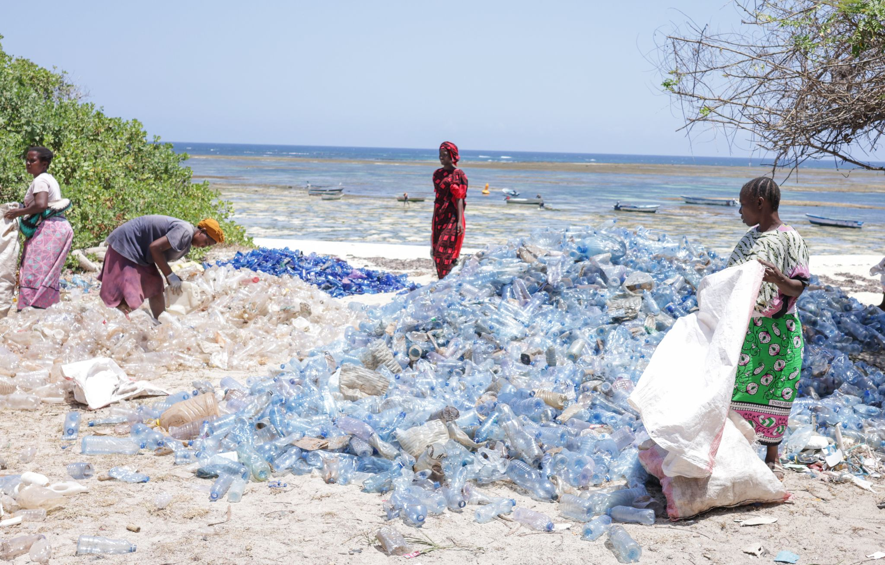
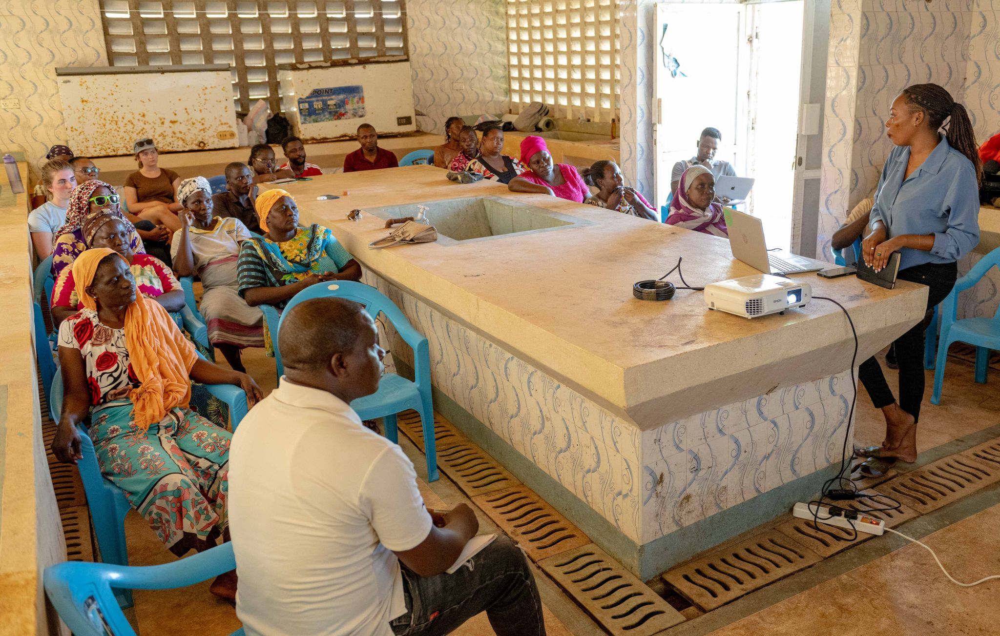

Fatuma Hamisi grew up watching the tide carry plastic onto the beach outside her door. She understood it was wrong the way you understand rain is wet - as a fact of life, not a solvable problem. She was twenty-six when an Oceans Alive community worker asked if she wanted to be paid to collect it.

That was three years ago. Today, Fatuma manages a collection group of fourteen women who together gather, sort, and sell more plastic than any other group on Kilifi's northern coast. She tracks their collection data on a phone she bought herself. She negotiates directly with the recycling buyer from Mombasa. She runs a savings scheme that has helped four members of her group pay secondary school fees they could not otherwise afford.

The Trash4Cash programme's environmental impact is easy to quantify: more than two tonnes of plastic removed from the coastal environment each month; cleaner beaches; fewer plastic-choked mangrove roots; fewer entanglements in fishing gear. The fishers who work near the collection areas notice the difference. The mangrove forest that lines part of Kilifi Creek, once visibly degraded by plastic accumulation, is recovering.

> "My husband used to decide everything about money in our house. Now I run a team of fourteen women and I decide our futures."
>
> — Fatuma Hamisi, Trash4Cash group leader, Kilifi North

But the programme's human impact is harder to put in a press release. It shows up in the way Fatuma describes making decisions. In the way her daughter, who is twelve, announced last month that she wants to study marine biology. In the savings books group members pull out at monthly meetings, tracking contributions that are building toward futures that plastic collection alone did not purchase - but made possible.

Oceans Alive designed Trash4Cash around the insight that women in coastal communities are the primary managers of household waste, and that they have the networks, the organisational capacity, and the motivation to run collection operations efficiently. What the programme provided was infrastructure: a guaranteed buyer, a fair price, basic equipment, and the legitimacy of a formal employer-employee relationship. In communities where it operates, women's incomes have increased by an average of 40%.
