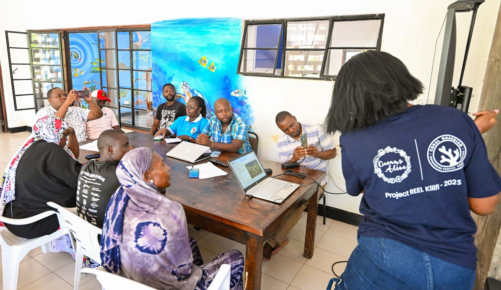
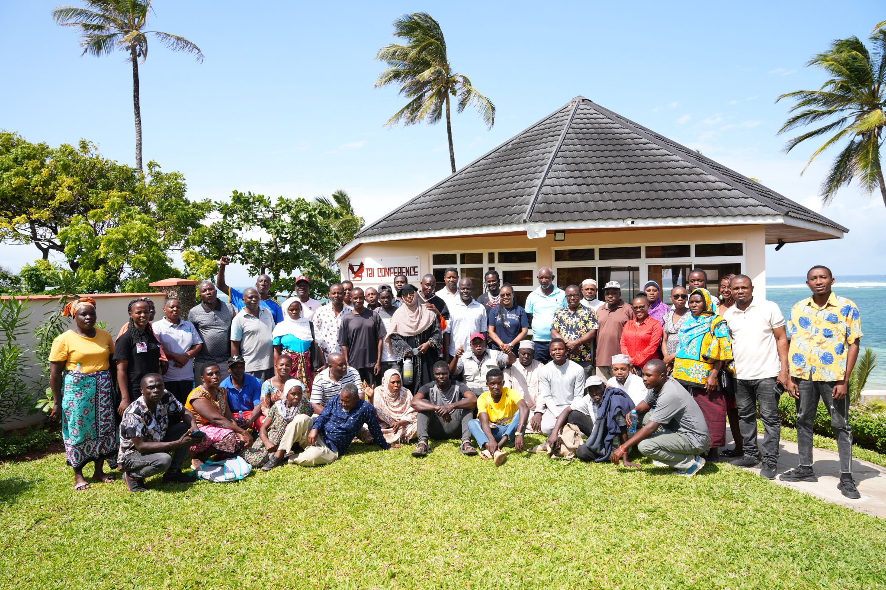

Each year, a cohort of aspiring conservation professionals - from Kenya and from around the world - arrives at Kuruwitu to learn what conservation looks like when it is done well. The Oceans Alive internship and capacity building programme is not an introductory experience. It is a deep immersion in community-led marine conservation at one of the most successful sites in the Western Indian Ocean.

Interns work alongside community reef monitors, BMU governance teams, ocean education officers, and research scientists. They assist with coral monitoring surveys, participate in community meetings, support school education days, and contribute to the research and monitoring programme that provides the evidence base for the co-management plan.

The programme prioritises Kenyan participants - particularly students from coastal counties who have direct connections to the communities and challenges that Oceans Alive addresses. Many alumni have gone on to work in conservation and fisheries management across East Africa, carrying the Kuruwitu model with them as a reference point for what community-led conservation can achieve.

> "The best conservation training is not in a classroom - it is in the field, alongside the communities who own the outcome."
>
> — Oceans Alive capacity building team

International interns contribute perspectives, skills, and networks that enrich the programme. Several have returned to their home countries to establish partnerships between their institutions and Oceans Alive, creating an ongoing exchange of knowledge and support that benefits both sides.

The programme also runs a separate strand for Kenyan government officers - fisheries inspectors, county environmental officers, and national park rangers - who spend time at Kuruwitu to understand how co-management governance works in practice. For many, it is the first time they have seen community and government working as genuine partners rather than adversaries.
