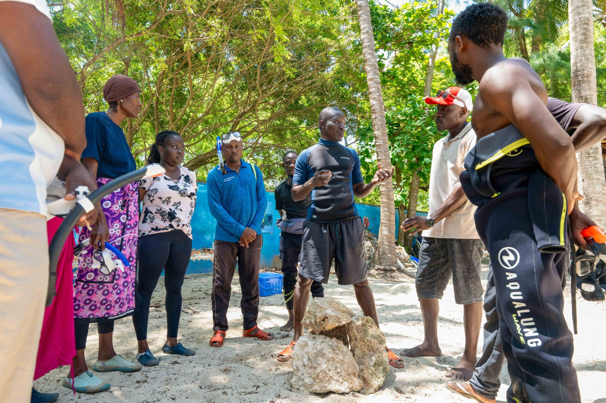
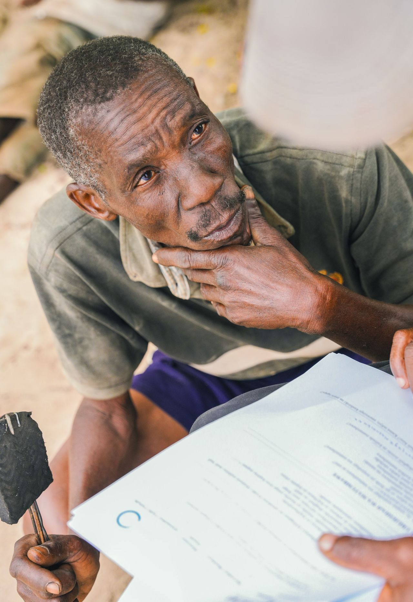

When Oceans Alive began its work in Kilifi County in 2003, the fishing communities it partnered with described a crisis: fish catches had declined by more than 60% over two decades. Reef fish that had once supported entire families were absent from the catches. Fishers were travelling further and staying out longer to bring in less.

The co-managed marine area at Kuruwitu was designed in part as a response to this crisis. By establishing no-take zones where fish can breed undisturbed and grow to maturity, the programme intended to rebuild fish populations that would then spill over into the surrounding fishing areas - providing fishers with larger, more sustainable catches without requiring them to travel as far.

Twelve years of monitoring data now show that this strategy is working. Fish biomass within the protected zone has increased by an estimated 40% compared to baseline measurements. Species richness - the number of different species present - has increased significantly, including the return of large predatory fish that indicate a healthy, functioning ecosystem.

> "My grandfather told me the sea used to be full of fish. Now my children are growing up with that same sea again."
>
> — Fisher, Kuruwitu BMU

Alongside the protected zone, Oceans Alive works with BMUs on gear transition programmes - supporting fishers to move away from destructive gear like beach seine nets and small-mesh gillnets toward more selective methods that allow juvenile fish to escape and breed. The programme provides training, connects fishers with suppliers of appropriate gear, and works with county fisheries officers to enforce regulations.

The results are not just ecological. Fishers report higher prices for their catch because larger fish command premium rates. With more fish available closer to shore, fuel costs have fallen. The combination of ecological recovery and economic improvement is creating exactly the kind of virtuous cycle that makes community conservation self-sustaining.
