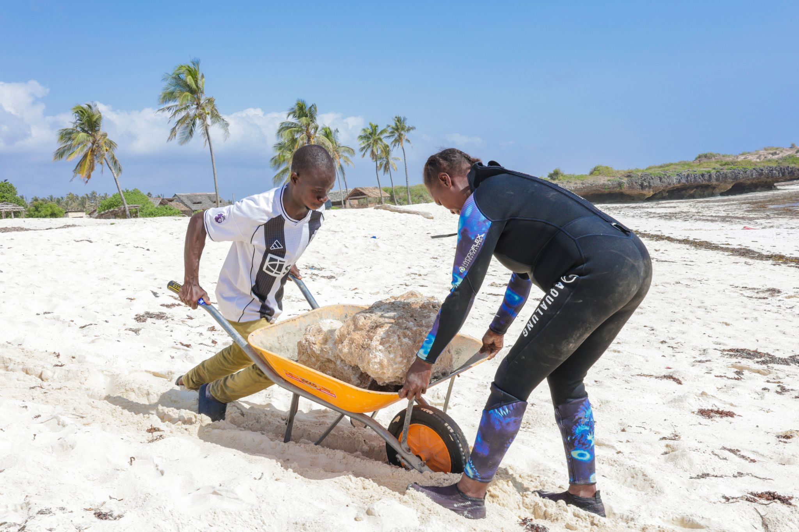
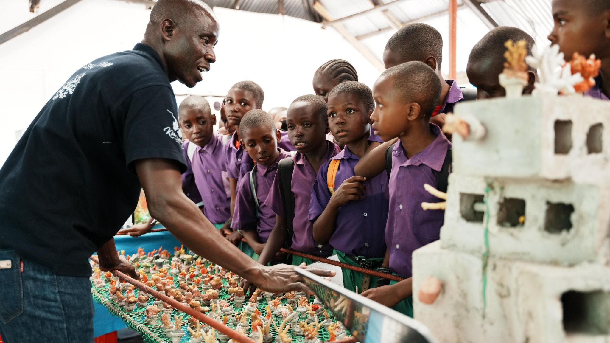

Katana Ngala is in the water before the sun is. On most mornings, he is the first person at the reef - checking the nursery frames before the visibility has fully improved, running his hands along the wire structures where hundreds of coral fragments grow on their way to becoming transplantable colonies. He can tell, by the way a coral feels and by its colour in the first grey light of the Indian Ocean morning, whether it has had a good week.

Katana grew up in Kilifi. As a young man, he fished - sometimes legally, sometimes in ways he now describes with a slight wince. He knew the reef was declining. Everyone knew. He just did not know what to do about it. When the coral restoration programme launched in 2019, he applied for training without being entirely sure what he was signing up for.

What he signed up for was becoming, over the next five years, one of East Africa's most skilled reef restoration practitioners. He has been trained in coral fragment harvesting, underwater nursery management, transplantation using stainless steel fixings and hydraulic cement, predator management, bleaching monitoring, and species identification. He has attended workshops in Madagascar and Mozambique. He has trained 40 other community members himself.

> "I know every nursery frame by touch. I know which corals are growing fast, which ones need watching. They are not just corals to me. I planted them."
>
> — Katana Ngala, Coral Restoration Technician, Oceans Alive Foundation

The programme's 85% coral survival rate - measured from nursery to twelve months post-transplant - is in large part a reflection of Katana's standards. He rejects fragments that do not look healthy enough. He moves corals that are in poor positions. He adjusts nursery depth when seasonal temperatures threaten to stress growing fragments. Conservation science happens in the university; the actual outcome happens with people like Katana in the water, making decisions in real time.

Ask him what the best moment of his career has been, and he does not hesitate. "There is a section of reef near the south nursery where we transplanted our first corals in 2019," he says. "Last month I dived there and counted forty-seven species of fish. In 2019, there were almost none. I did that. The community did that. That is the best feeling I have ever had."
