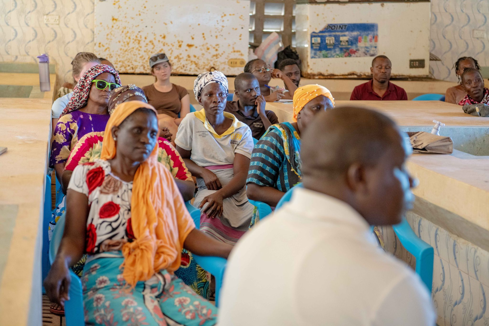
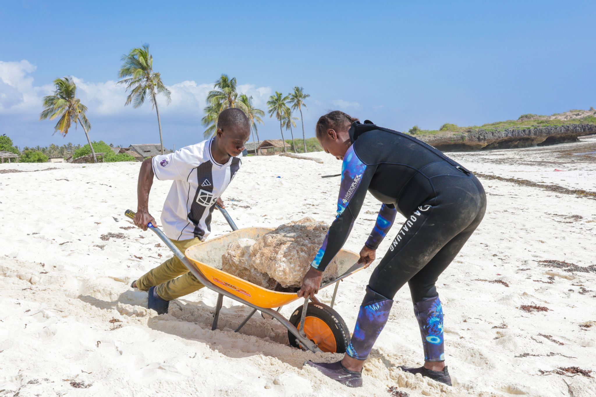

In 2023, His Majesty King Charles III visited the Kuruwitu conservation project during his official visit to Kenya. For the community members who had spent two decades building what he came to see, it was a moment of extraordinary validation.

The King was brought to Kuruwitu as part of a programme designed to showcase Kenya's leadership in community-based conservation. He met with community divers, BMU representatives, women from the Trash4Cash programme, and the young students who had been through the ocean education curriculum. He snorkelled over the restored reef section and spoke at length with the fishers who first created the marine sanctuary.

The coverage was immediate and global. Images of the King speaking with Kilifi's fishing communities reached audiences around the world, bringing unprecedented attention to the Kuruwitu model and to Kenya's ocean conservation leadership more broadly.

> "What you have built here - the partnership between people and their ocean - is exactly what the world needs more of."
>
> — His Majesty King Charles III, Kuruwitu, 2023

For Oceans Alive, the visit was significant not just symbolically but practically. In the weeks that followed, inquiries from international conservation organisations, government ministries from seven countries, and potential funding partners increased dramatically. Several new partnerships - including a research collaboration with a UK university and a conservation film commission - trace their origins directly to the attention generated by the royal visit.

But ask anyone in Kuruwitu what they remember most, and they are likely to tell you not about the cameras or the international coverage - but about the moment the King listened, genuinely listened, as the BMU chair explained why the reef matters to their children's future.
