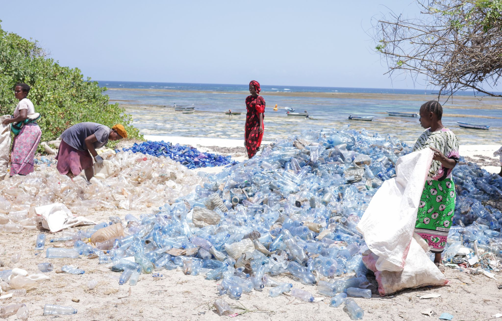
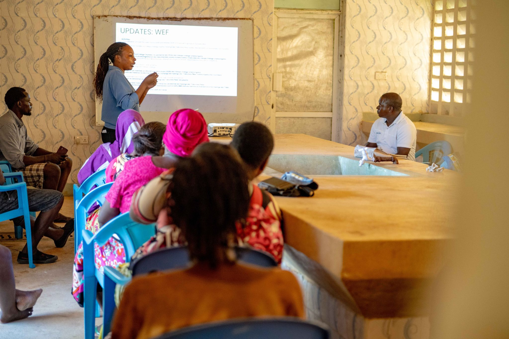

Every month, more than two tonnes of plastic waste are collected from the beaches, mangroves, and waterways of Kilifi County by a network of over 80 women. They sort it, weigh it, and sell it to recycling partners - earning a reliable income while protecting the coastline that their communities depend on.

Trash4Cash began as a simple idea: pay community members for the plastic they collect. What Oceans Alive discovered quickly was that women - who often bear the burden of managing waste in their households and communities - were by far the most organised and committed collectors. The programme was redesigned around their leadership.

Each collection point is run by a women's group that organises their own schedules, manages the weighing and recording, and negotiates with recycling buyers. The groups have become micro-enterprises, reinvesting a portion of their earnings into group savings schemes and school fees for their children.

> "Before Trash4Cash, plastic was just a problem. Now it is our business, our income, and our pride."
>
> — Trash4Cash participant, Kilifi

The environmental impact is direct and measurable: plastic that would otherwise enter the ocean is intercepted at source. Kilifi's beaches, which once accumulated significant plastic during rains, are visibly cleaner. Fisher communities report less plastic in their nets. Mangrove ecosystems, which trap plastic debris in their root systems and slowly suffocate, are recovering.

But Trash4Cash is more than an environmental programme. It is a women's economic empowerment programme that uses the environment as its entry point. Participants have used their earnings to start small businesses, repair houses, and pay secondary school fees. The programme has created a model that other coastal counties in Kenya are now beginning to replicate.
