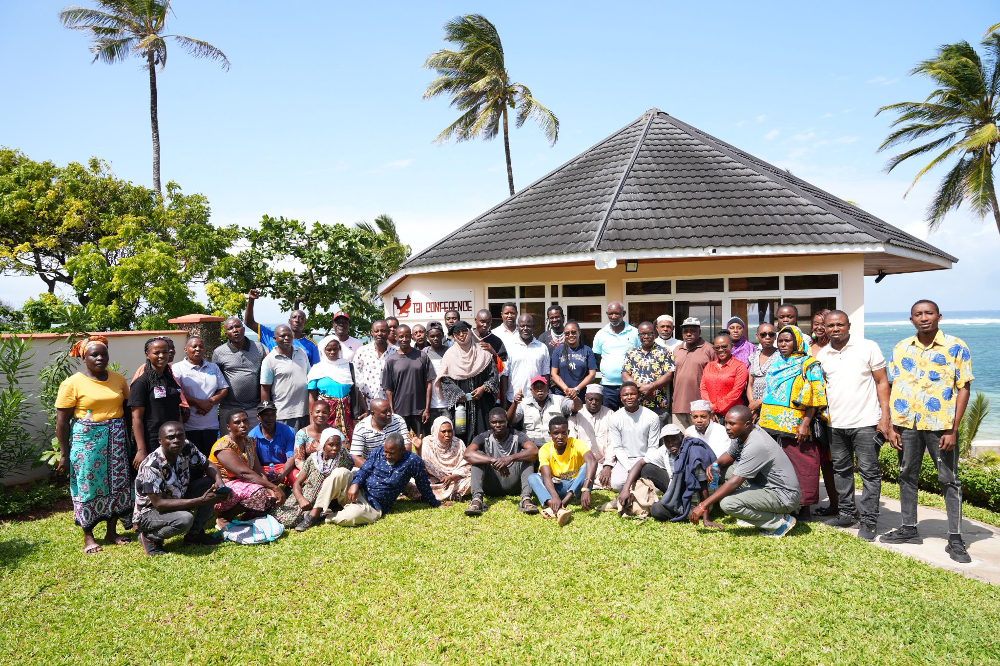
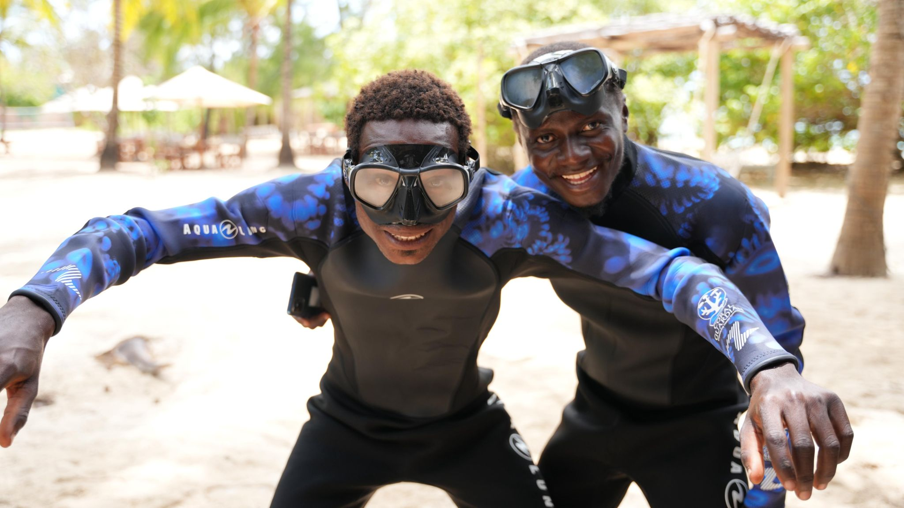

We are looking for twenty people who want to do something real. Not symbolic conservation tourism, not photo opportunities - real work. Joining Oceans Alive's Q3 2025 coral survey team means spending six days learning a scientifically rigorous reef monitoring methodology and then putting it to use on one of East Africa's most closely monitored marine ecosystems.

The coral monitoring survey is conducted every quarter at Kuruwitu. Trained teams use point intercept transect methodology to assess live coral cover, dead coral, algae cover, and substrate composition across permanent monitoring sites. Fish biomass surveys run alongside, using underwater visual census techniques. The data collected feeds directly into the annual monitoring report underpinning the BMU's co-management plan and Kenya Fisheries Service compliance assessments.

This is not a beginners' snorkelling holiday. It is volunteer-powered science. But no prior marine biology experience is required - what is required is the ability to swim comfortably, the willingness to spend up to four hours in the water daily, and the patience for methodical work that does not always produce dramatic results but is the foundation of everything that the dramatic results depend on.

> "The best volunteers are not always the ones with the most experience. They are the ones who can be genuinely useful within six days - and never stop wanting to know what is down there."
>
> — Coral survey coordinator, Oceans Alive Foundation

Training takes place over the first six days of the programme, led by Oceans Alive's research team and experienced community divers including Katana Ngala - the lead coral restoration technician who has been monitoring this reef daily since 2019. You will learn coral species identification, survey methodology, data recording, and underwater navigation. By the end of training week, you will be conducting surveys independently.

The programme runs from July 14th to August 8th 2025. Volunteers commit to a minimum of two weeks, with the option to extend. Accommodation can be arranged at the Kuruwitu community lodge at cost price. International volunteers are welcome; Kenyan nationals from coastal counties are particularly encouraged to apply. To apply, email volunteer@oceansalive.org with a brief paragraph about why you want to join. No formal form - just tell us who you are.
