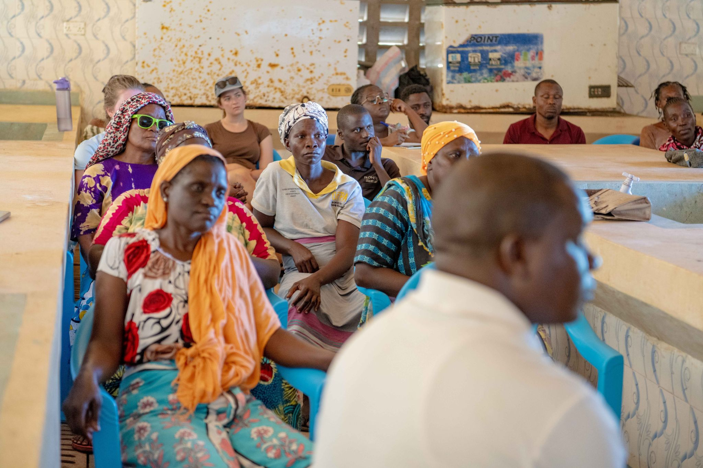
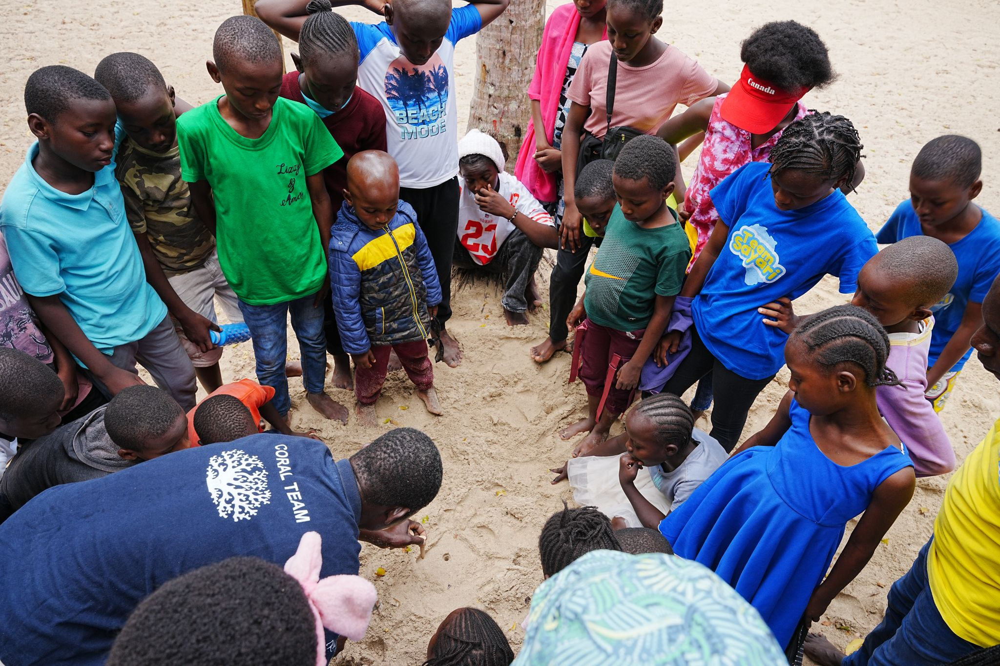

World Ocean Day 2024 was unlike any before it in Kilifi County. More than 800 community members, school students, government officials, and conservation partners came together at Kuruwitu to celebrate twenty years of coastal stewardship - and to look ahead at what the next twenty could bring.

The day began before dawn with a community dive. Twelve certified reef gardeners descended together to the coral nurseries and the transplanted reef sections - the most experienced among them pausing over individual coral colonies they could remember planting five years ago, now large and branching, hosting small fish and invertebrates in their structure.

On shore, school children performed conservation-themed performances, BMU representatives led guided walks of the reef flat, and researchers presented monitoring data showing the recovery of fish populations within the protected zone. A photographic exhibition documented two decades of change: bleached rubble becoming structured reef; depleted fishing grounds becoming managed marine areas.

> "Twenty years ago we had almost nothing left. Today, we have a reef that is alive. That is what a community can do."
>
> — Des Bowden, CEO, Oceans Alive Foundation

The centrepiece of the day was a community address that named each of the forty-plus certified divers by name, and the thousands of community members who had contributed to the programme through their governance participation, their restraint from destructive fishing, and their commitment to the co-management plan.

As the sun set over the Indian Ocean, the message that emerged was not one of celebration alone - it was one of continuation. The reef is recovering. The community is united. The model is working. But the ocean still faces existential threats from climate change, from illegal fishing, from plastic pollution, from the relentless pressure of coastal development. The work of the next twenty years will be even more important than the work of the last.
