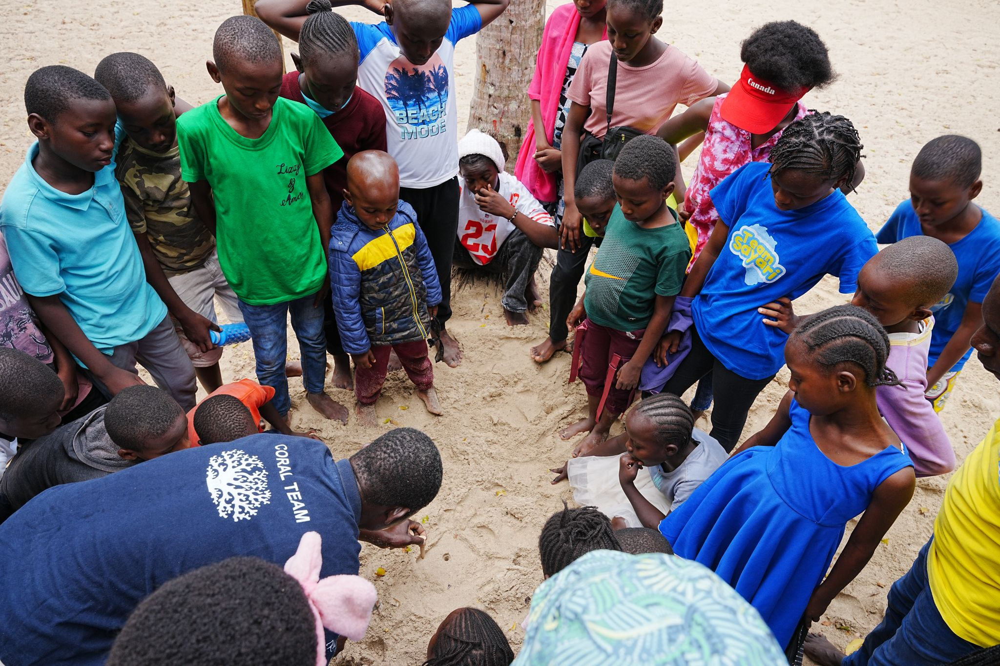
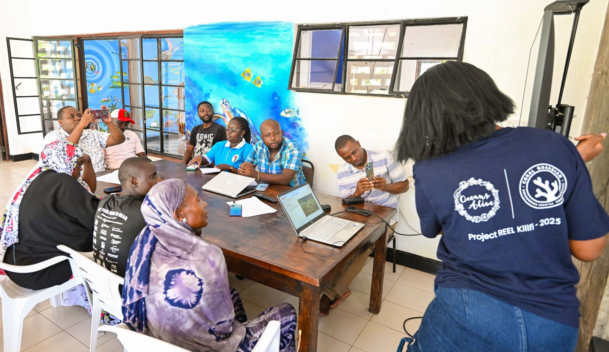

On June 8th, 2025 - World Ocean Day - the Indian Ocean will be the main stage, and everyone in Kilifi County is invited.

This year's celebration is the most ambitious Oceans Alive has hosted. It begins at 6 AM with a community reef walk at low tide - guided by trained community educators, open to all ages, no experience required. At 8 AM, twelve certified community divers will descend to the coral nurseries and transplanted reef sections for a simultaneous restoration dive, with underwater cameras broadcasting live to a screen on the beach. Children can watch the reef gardeners at work in real time.

At 10 AM, we will officially open the Watamu Youth Marine Education Centre - a permanent facility that will host school groups, youth conservation training, citizen science workshops, and international research collaborations year-round. The centre has been two years in planning and represents the most significant investment Oceans Alive has made in ocean education infrastructure to date.

> "Every year Ocean Day gets bigger. This year, the reef itself will be the centrepiece. We want everyone in Kilifi to touch it and understand what they are protecting."
>
> — Tilda Bowden, Education Director, Oceans Alive Foundation

The afternoon programme includes a live music stage featuring coastal Kenya artists, a community conservation market hosted by the LIFT Network, interactive species identification workshops, and the public launch of the OAF Reef Monitor app - a citizen science platform allowing registered community members to log reef observations, report violations, and track fish populations from their phones.

There will be food, music, and children snorkelling for the first time. But at the centre of all of it will be the reef itself - the same reef that was rubble twenty years ago and is now one of the most closely studied and genuinely recovering coral ecosystems in the Western Indian Ocean. All events are free. To receive programme updates and register for the guided reef walk, contact us through the website or WhatsApp.
