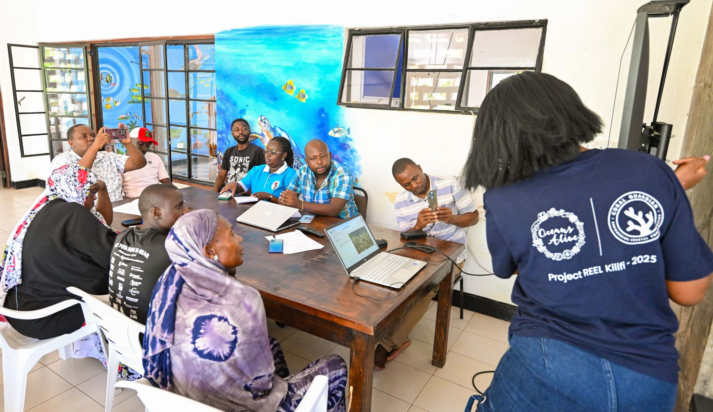
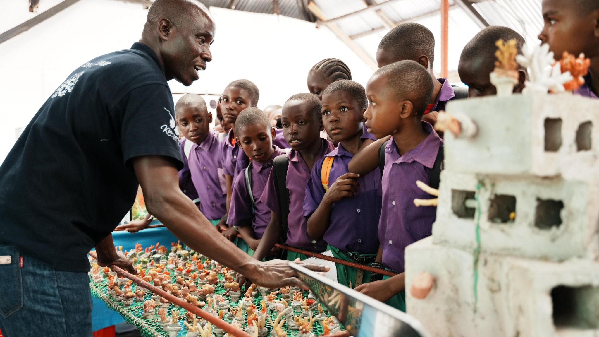

For a generation of children growing up along Kenya's coast, the ocean has always been there - but it has not always been understood. Oceans Alive Foundation's ocean education programme has reached over 2,500 students across Kilifi County with hands-on marine conservation learning that turns curiosity into commitment.

The programme runs in partnership with local primary and secondary schools. Students visit the Kuruwitu marine sanctuary for field days that include snorkelling in the protected zone, coral identification sessions, and meetings with the community divers who maintain the reef restoration nurseries. Many children are meeting a coral reef in person for the first time.

Back in the classroom, teachers trained by Oceans Alive run a curriculum that covers marine biodiversity, the causes and effects of reef degradation, the science of coral reproduction, and the role of community governance in protecting marine resources. The curriculum is designed to be practical, local, and linked to the lives the children already live.

> "When a child understands why the reef matters, they become its guardian for life. That is the programme we are building."
>
> — Ocean Education team, Oceans Alive

The results are visible in the community. Children who went through the programme three or four years ago are now secondary school students who volunteer at clean-up events, challenge peers who damage the reef, and - in several cases - have gone on to study environmental science. Some are now interning with the research and monitoring team.

Oceans Alive also runs a parallel youth leadership stream for older students, pairing them with conservation staff for structured learning placements. Several of today's community conservation officers began as participants in the youth education programme more than a decade ago.
